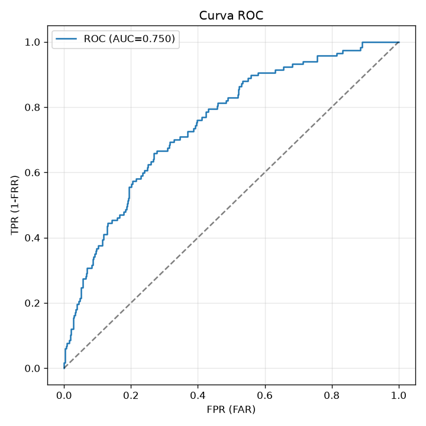
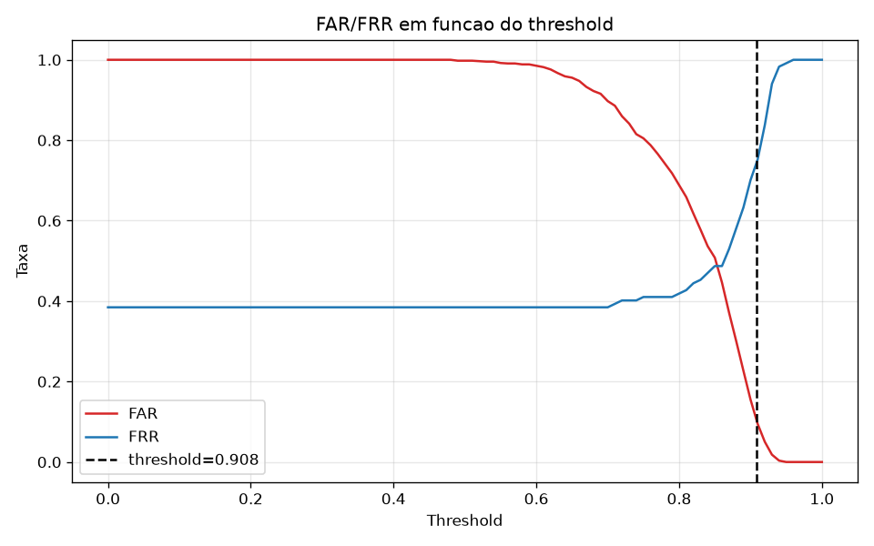
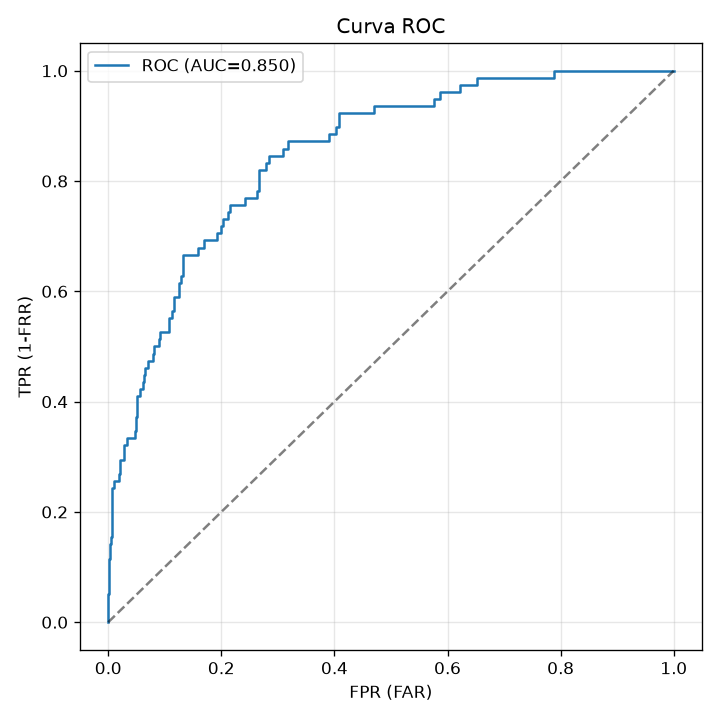
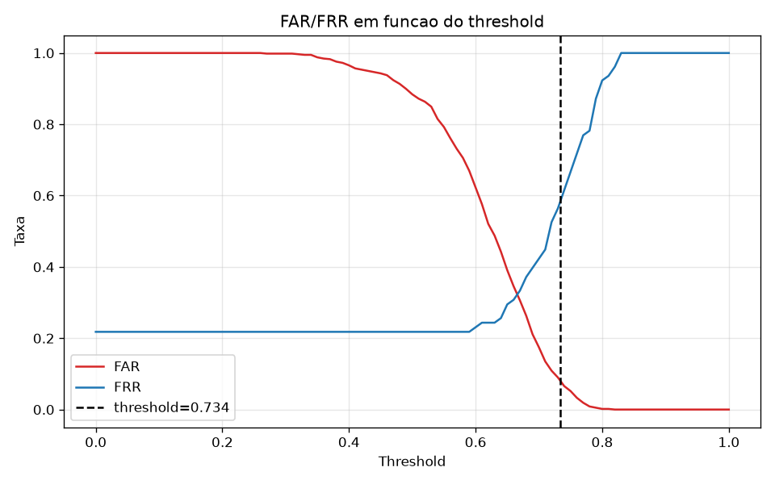
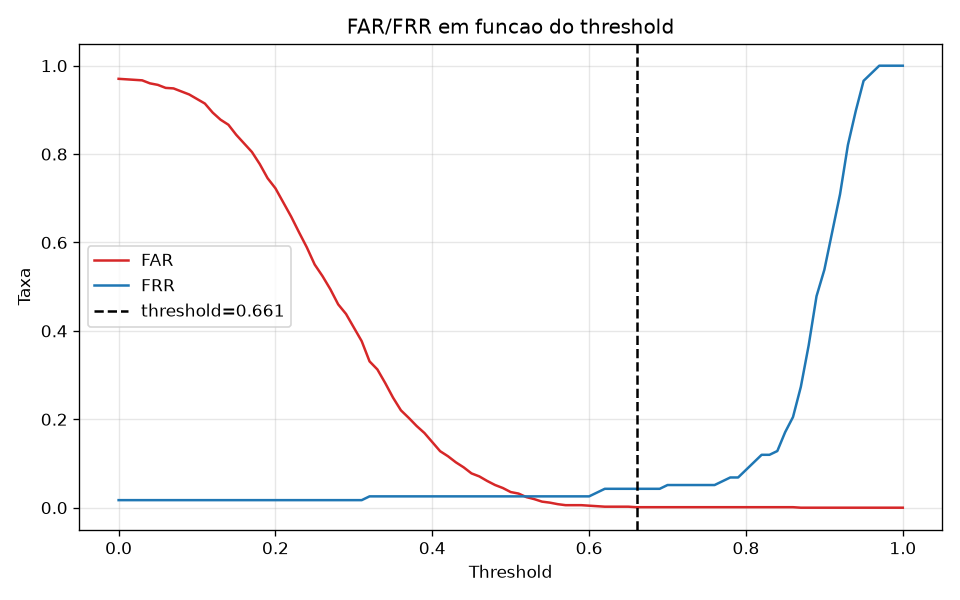
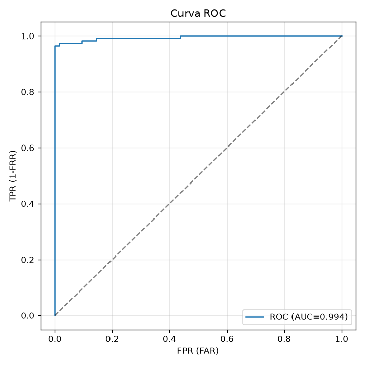
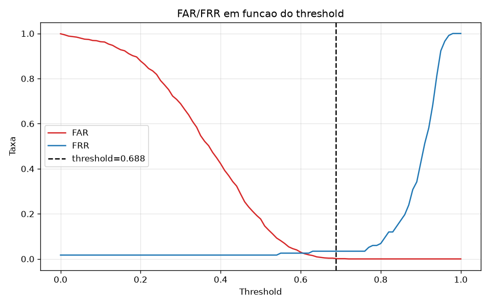
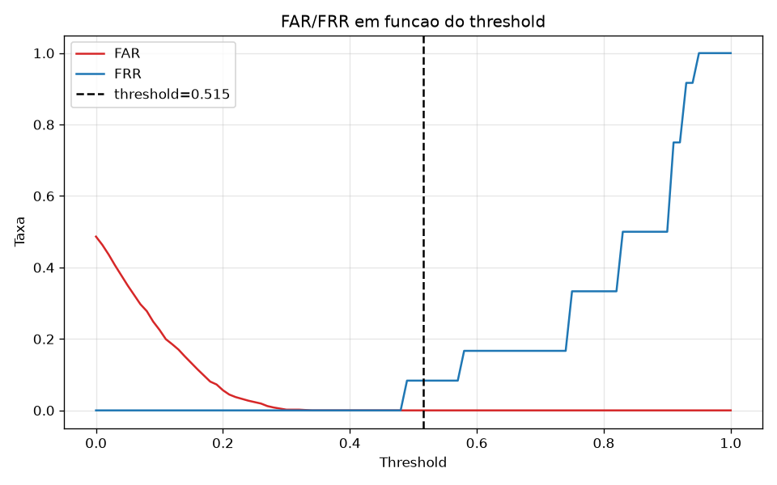

# Reconhecedor Facial

Este repositório armazena a implementação de pipeline de reconhecimento facial replicável, onde cada replicação com modelo/dataset diferente é um experimento. Este sistema faz parte de um trabalho sobre reconhecimento facial por meio de técnicas de inteligência artificial.

Você pode consultar a pasta docs para entender quais funcionalidades o sistema pretende implementar e sobre quais restrições.

## Sumário 
 - [Hipóteses dos experimentos do sistema](#hypothesis)
 - [Resultados e Discussão](#resultados)
 - [Arquitetura do sistema](#requisites)
 - [Como instalar as dependências](#instalacao)
 - [Como utilizar o sistema](#utilizacao)

<h2 id="hypothesis">Hipóteses dos experimentos de reconhecimento facial</h2>

Seja experimento definido como a combinação de um modelo para detecção de faces, um modelo para reconhecimento e geração de embeddings e um dataset. Deseja-se testar qual é a combinação, isto é, experimento, que tem o melhor desempenho relacionado ao reconhecimento facial e rejeição de faces desconhecidas.

### Lista dos Experimentos 

Os experimentos implementados nesse projeto estão dispostos a seguir no formato (detecção + reconhecimento + dataset), com detalhes técnicos contidos na ADR-003-experiments-list.
 - E01 : YuNet + ResNet50 (baseline) + Labeled Faces in the wild
 - E02 : YuNet + ResNet50 (fine-tuned) + Labeled Faces in the wild
 - E03 : FaceNet + FaceNet + Labeled Faces in the wild
 - E04 : YuNet + FaceNet + Labeled Faces in the wild
 - E05 : YuNet + FaceNet + (Labeled Faces in the wild + Dados Privados do Autor)

### Hipóteses Específicas
A seguir estão dispostas as hipóteses sobre desempenho dos experimentos.
 - **H1 - Efeitos do Fine-Tuning no desempenho (E01xE02)** : O experimento E02 apresentará maior precisão e maior recall em relação ao E01, sem aumento relevante nas métricas de falsos positivos e falsos negativos. A justificativa proposta é de que o fine-tuning do modelo o fará mais adequado ao problema de reconhecimento facial.
 - **H2 - Efeitos do fine-tuning da distribuição de falsos positivos e falsos negativos (E01xE02)** : O experimento E02 apresentará uma distribuição entre falsos positivos e falsos negativos significativamente diferente de E01. A justificativa proposta é que o fine-tuning altera o perfil de erros no processo de reconhecimento facial. 
 - **H3 - Comparação entre Fine Tuning e Treinamento Especializado (E02xE04)** : O experimento E04 apresentará maior acurácia e maior recall em relação ao E02, mantendo ou melhorando a métrica de precisão. A justificativa é de que o modelo de reconhecimento do E04 foi treinado de forma especializada para o problema de reconhecimento facial.
 - **H4 - Efeitos do detector facial no desempenho (E03xE04)** : O experimento E03 apresentará resultados significativamente diferentes em relação ao E04, aumentando o nível de acurácia. A justificativa proposta é a diferença do objetivo de treinamento de cada modelo (Detecção x Reconhecimento).
 - **H5 - Diferenças de dataset (E04xE05)** : O experimento E05 não apresentará diferenças significativas em relação ao E04 no que concerne acurácia e precisão. A justificativa proposta é que a inserção da face do autor não terá efeito significativo no experimento. Este experimento apresenta ameaça a sua validade por conta do tamanho da amostra.

<h2 id="resultados"> Resultados dos experimentos </h2>

### Tabela de Resultados
| Experimento | Detector | Reconhecedor | Dataset | Acurácia | Precisão | Recall | FAR | FRR |
|-------------|----------|--------------|---------|----------|----------|--------|-----|-----|
|E01|YuNet|ResNet50 (Baseline)|LFW|0.8217|0.2500|0.2564|0.1027|0.7435|
|E02|YuNet|ResNet50 (Fine Tuned)|LFW| 0.8528|0.4074|0.4230|0.0830|0.5769|
|E03|FaceNet| FaceNet| LFW| 0.9939|0.9915|0.9572|0.0011|0.0427|
|E04|YuNet|FaceNet| LFW |0.9949|0.9912|0.9658|0.0011|0.0341|
|E05|YuNet|FaceNet| LFW+Private | 0.9990|1.0000|0.9166|0.0000|0.0833|

Observação :  Os resultados dos experimentos são detalhados nos arquivos metrics.json de cada experimento contido no repositório.

### Gráficos

A seguir são dispostos os gráficos de Curva ROC e Curva FAR-FRR de cada experimento realizado.

#### Experimento 01




#### Experimento 02




#### Experimento 03




#### Experimento 04




#### Experimento 05




### Discussão

#### H1 - Efeitos do Fine-Tuning no desempenho (E01xE02)

Os dados corroboram com a hipótese, tendo em vista que acurácia, precisão e recall aumentaram e as métricas de FAR e FRR diminuíram.

#### H2 - Efeitos do fine-tuning da distribuição de falsos positivos e falsos negativos (E01xE02)

Os dados são inconclusivos, contudo é possível observar que o limiar de desconhecimento do E02, que contém fine tuning, é consideravelmente menor. 

#### H3 - Comparação entre Fine Tuning e Treinamento Especializado (E02xE04)

Os dados corroboram com a hipótese, tendo em vista o aumento significativo nas métricas de acurácia, precisão e recall.

#### H4 - Efeitos do detector facial no desempenho (E03xE04)

Os dados não corroboram com a hipótese pois a variação nas métricas foi pouco significante. Mesmo nesse caso o E03 teve uma menor acurácia.

#### H5 - Diferenças de dataset (E04xE05)

Os dados corroboram com a hipótese, contudo as métricas de recall, far e frr apresentaram variação significativa, podendo indicar que a inclusão de dados privados alterou o perfil de reconhecimento dos modelos. Em contrapartida, o tamanho da amostra enfraquece a análise e evidencia a necessidade de testes com bases de dados maiores.

<h2 id="arquitetura">Arquitetura do Sistema</h2>

O pipeline é implementado por meio de uma arquitetura em camadas, cada uma com interface própria em `src/reconhecedor/`:

| Camada           | Pacote                | Responsabilidade                                      |
|------------------|-----------------------|-------------------------------------------------------|
| Dataloader       | `dataloader/`         | Carregar imagens de datasets públicos ou por arquivos (`.png/.jpg/.jpeg`). Gallery armazena as pessoas conhecidas pelo sistema e probe os conjuntos de teste e validação.     |
| FaceDetector     | `face_detector/`      | Detectar faces, descartar imagens sem face, recortar imagens com face para simplificação da imagem. |
| PreProcessor     | `preprocessor/`       | Padronizar a entrada da Model|
| Model            | `model/`              | Gerar o embedding facial (interface `Model`;) |
| FaceRecognition  | `face_recognition/`   | Comparar embeddings; reconhecer ou declarar `None`    |
| Evaluator        | `evaluator/`          | Métricas por experimento, salvas em arquivo           |

O arquivo `src/reconhecedor/pipeline.py` orquestra o fluxo genérico; as camadas chegam por
**injeção de dependência**, então trocar a Model (ex.: FaceNet/ArcFace) não exige alterações no pipeline — basta implementar `Model.embed`.

<h2 id="instalacao">Instalação</h2>

Requer Python 3.10+ (testado em 3.14, Windows).

```powershell
pip install -r requirements.txt
```

<h2 id="utilizacao">Como utilizar</h2>

### Comandos

```powershell

# Lista os experimentos de src/experiments/
python main.py experiments

# Roda o experimento baseline de ponta a ponta
python main.py run

# Consulta o histórico de métricas (na subpasta de cada experimento)
python main.py metrics

# Consulta informações sobre utilização do sistema
python main.py help

# Consulta informações sobre utilização do comando run
# (Use esse comando para ver quais parâmetros podem ser escolhidos)
python main.py run --help
```

### Parâmetros

```powershell

# Define experimento, dataset, treshold e tamanho padrão das imagens via argumentos
python main.py run --experiment baseline --dataset data/meu-dataset `
                   --threshold 0.8 --image-size 128

# Consulta o histórico de métricas do experimento baseline
python main.py metrics --experiment baseline